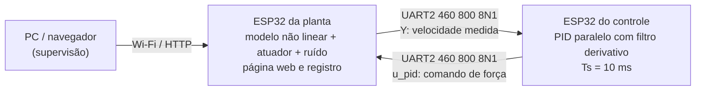
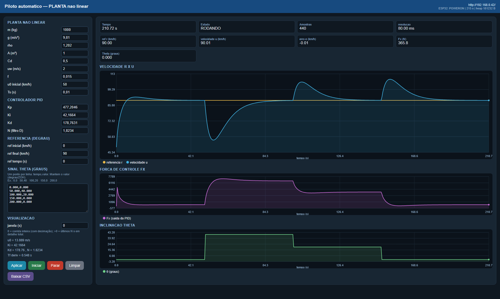
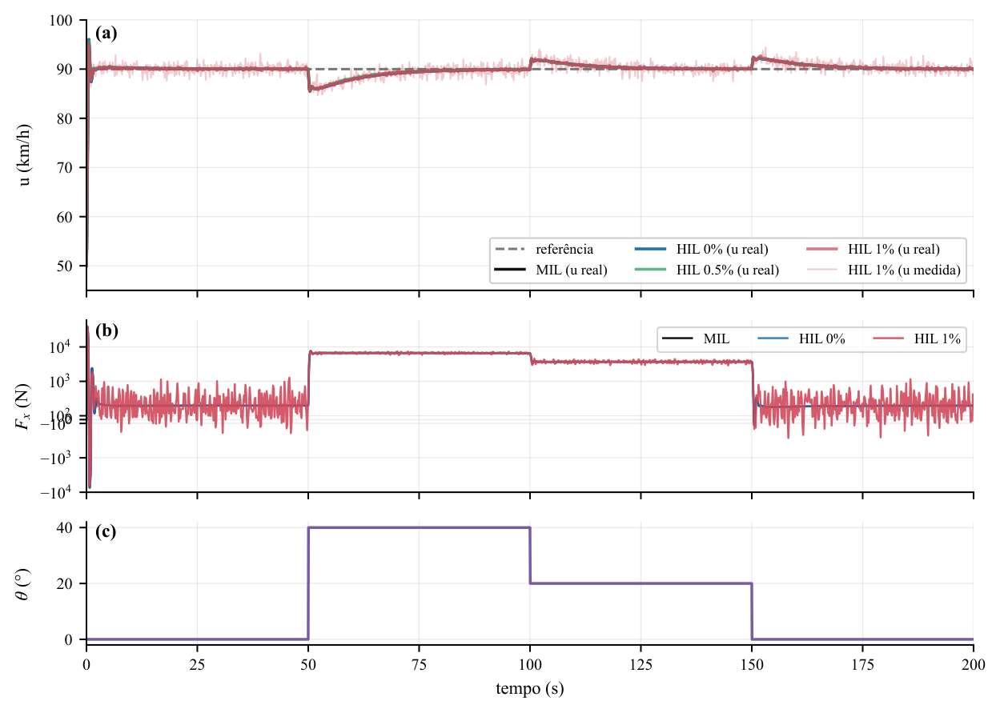
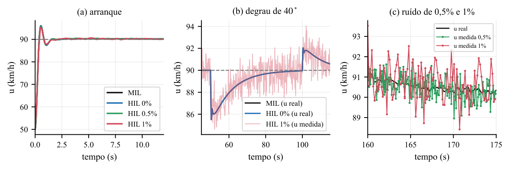
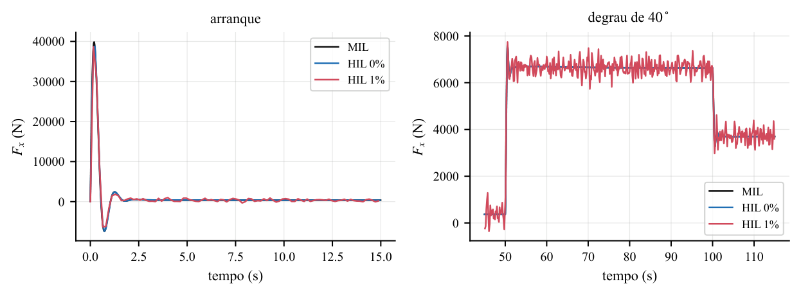

# Piloto automático não linear com ESP32 — plataforma HIL

**Comparação MIL versus HIL de um controlador PID para controle longitudinal de velocidade**

[](LICENSE)


**Autor:** Kaique de Sotti Silva
Universidade Federal de Lavras (UFLA) — Departamento de Automação (DAT)
`kaique.silva@estudante.ufla.br`

**Artigo:** *Plataforma Hardware-in-the-Loop para Controle Longitudinal (Piloto Automático) Não Linear com ESP32: Comparação MIL versus HIL* (2026)

---

## Sobre

Este repositório reúne o código-fonte, o modelo Simulink, os dados experimentais e a documentação de uma bancada **hardware-in-the-loop (HIL) de baixo custo** para o controle longitudinal de velocidade de um veículo.

A planta e o controlador rodam em **dois ESP32-WROOM-32 independentes**. A malha de controle fecha por **UART2 com fios** (460 800 bit/s); a conexão Wi-Fi da planta serve apenas à configuração e à telemetria. A planta implementa o modelo longitudinal não linear com arrasto aerodinâmico, resistência ao rolamento e inclinação da pista, acrescido do atuador de borboleta de primeira ordem e de ruído gaussiano de medição. O controlador é um PID paralelo com filtro derivativo executado a 100 Hz (Ts = 10 ms).

O modelo Simulink (MIL) foi executado com os mesmos parâmetros e comparado a três ensaios HIL, com níveis de ruído de medição de **0 %, 0,5 % e 1 %**.

**Principais resultados:**

| Ensaio | RMSE da velocidade real | RMSE da velocidade medida | Correlação com o MIL |
|---|---|---|---|
| HIL 0 % | 0,030 km/h | 0,030 km/h | 0,9998 |
| HIL 0,5 % | 0,118 km/h | 0,392 km/h | 0,9970 (real) / 0,9661 (medida) |
| HIL 1 % | 0,174 km/h | 0,760 km/h | 0,9932 (real) / 0,8840 (medida) |

O atraso estimado entre HIL e MIL foi de **5 ms**. O pico de força de aproximadamente **39 kN** no arranque decorre da ausência de saturação no modelo.

---

## Arquitetura



| Placa | Responsabilidades | Rede |
|---|---|---|
| **ESP32 da planta** | Modelo longitudinal não linear, atuador da borboleta, ruído de medição, condição inicial, perfil θ(t), registro e página web | Wi-Fi (STA) + UART2 |
| **ESP32 do controle** | PID paralelo com filtro derivativo, integração do erro e envio do comando u_pid | Apenas UART2 |

A escolha de duas placas separa fisicamente a planta do controlador: o controlador é o código embarcado real e a planta é um modelo executado em tempo real, que é a definição de HIL adotada no trabalho. Um computador apenas supervisiona e coleta os dados; ele não participa da malha de controle.

> [!IMPORTANT]
> As duas placas não compartilham um relógio de hardware. Cada uma mantém sua própria base de tempo incrementada por Ts; para a referência em t = 0 isso é inofensivo, mas degraus em t > 0 podem apresentar defasagem de poucos milissegundos entre as bases.

---

## Estrutura do repositório

```text
.
├── firmware/
│   ├── controle/
│   │   └── controle.ino               # PID embarcado (ESP32 do controle)
│   └── planta/
│       ├── planta.ino                 # modelo, atuador, ruído e servidor web
│       ├── index_html.h               # página web embutida (HTML/CSS/JS)
│       ├── secrets.example.h          # modelo de credenciais Wi-Fi
│       └── secrets.h                  # credenciais locais (NÃO versionado)
├── matlab/
│   ├── nao_linear_piloto_automatico.slx    # modelo Simulink (MIL)
│   ├── Modelo_nao_linear.m                 # equação da planta usada no Simulink
│   ├── NL_Parametros_Piloto_automatico.m   # parâmetros do modelo
│   ├── run_mil_export.m                    # executa o MIL e exporta o CSV
│   └── SINAL_RAMPA_1.mat                   # perfil θ(t) do Signal Editor
├── resultados_HIL/
│   ├── README.md                      # dicionário de dados dos CSVs
│   ├── metricas_mil_hil.csv           # métricas consolidadas
│   ├── resultado_MIL.csv              # simulação MIL (grade de 10 ms)
│   ├── resultado1_0_ruido.csv         # HIL, ruído de 0 %
│   ├── resultado1_0.5_ruido.csv       # HIL, ruído de 0,5 %
│   └── resultado1_1.0_ruido.csv       # HIL, ruído de 1 %
├── docs/
│   ├── PROTOCOLO_UART.md              # especificação do enlace e da API web
│   └── img/                           # capturas e figuras usadas na documentação
├── Artigo_e_slide_editavel/
│   ├── Artigo_Controle_automotivo.zip # fontes LaTeX do artigo
│   └── Slides_Controle_automotivo.zip # fontes LaTeX dos slides
├── Artigo_Plataforma Hardware-in-the-Loop ... .pdf   # artigo compilado
├── slides_Controle de velocidade (Piloto automático) não linear.pdf
├── CITATION.cff
├── LICENSE
└── README.md
```

---

## Hardware necessário

| Item | Quantidade | Observação |
|---|---|---|
| ESP32-WROOM-32 (DevKit) | 2 | uma placa para a planta, outra para o controle |
| Cabos USB | 2 | alimentação e gravação independentes |
| Jumpers | 3 | TX, RX e GND |
| Rede Wi-Fi | 1 | a planta entra como estação (STA); o PC deve estar na mesma rede |
| Computador | 1 | supervisão via navegador |

> [!WARNING]
> **Não interligue os barramentos de 3,3 V.** Cada placa deve ser alimentada pelo seu próprio cabo USB. Apenas TX, RX e GND são conectados entre as placas.

### Ligação UART2

| ESP32 da planta | ESP32 do controle | Observação |
|---|---|---|
| GPIO17 (TX2) | GPIO16 (RX2) | TX da planta → RX do controle |
| GPIO16 (RX2) | GPIO17 (TX2) | TX do controle → RX da planta |
| GND | GND | referência comum obrigatória |
| 3V3 | — | **não conectar** |

As ligações são cruzadas (TX → RX). A figura 4 do artigo detalha a montagem.

---

## Firmware

### Requisitos

- [Arduino IDE 2.x](https://www.arduino.cc/en/software) com o pacote **ESP32 by Espressif Systems** instalado pelo Boards Manager.
- Placa selecionada: **ESP32 Dev Module** (ou equivalente ESP32-WROOM-32).
- Nenhuma biblioteca externa: `WiFi`, `WebServer` e `esp_system` fazem parte do core do ESP32.
- Velocidade do Monitor Serial: **115 200 bit/s**.

### 1. Configurar as credenciais Wi-Fi

```bash
cp firmware/planta/secrets.example.h firmware/planta/secrets.h
```

Edite `firmware/planta/secrets.h`:

```cpp
#define WIFI_SSID "NOME_DA_REDE"
#define WIFI_PASSWORD "SENHA_DA_REDE"
```

O arquivo `secrets.h` está listado no `.gitignore` e não é versionado. Sem ele, o sketch da planta não compila (a inclusão é intencional, para evitar publicar credenciais por engano).

### 2. Gravar o ESP32 da planta

1. Abra `firmware/planta/planta.ino` na Arduino IDE.
2. Selecione a placa **ESP32 Dev Module** e a porta COM correspondente à placa da planta.
3. Faça o upload.
4. Abra o Monitor Serial em 115 200 bit/s. A mensagem `PAGINA WEB: http://192.168.x.x` informa o endereço da interface.

### 3. Gravar o ESP32 do controle

1. Abra `firmware/controle/controle.ino`.
2. Selecione a **outra** porta COM (a placa do controle).
3. Faça o upload.

O ESP32 do controle não usa Wi-Fi: ele apenas recebe a configuração e a velocidade medida, calcula o PID e devolve o comando pela UART2.

### 4. Operar a bancada

1. Alimente as duas placas pelos respectivos cabos USB.
2. Conecte o computador à mesma rede configurada em `secrets.h`.
3. Abra no navegador o endereço IP exibido no Monitor Serial da planta.
4. Ajuste os parâmetros desejados e clique em **Aplicar**.
5. Clique em **Iniciar** para começar o ensaio; **Parar** interrompe, **Limpar** reinicia o histórico e **Baixar CSV** exporta a corrida.
6. O perfil padrão é: u0 = 50 km/h, degrau de referência para 90 km/h em t = 0 e θ(t) = 0° até 50 s, 40° entre 50 s e 100 s, 20° entre 100 s e 150 s e 0° a partir de 150 s (ZOH).



A página permite ajustar os parâmetros da planta (`m`, `g`, `ρ`, `A`, `Cd`, `uw`, `f`), do atuador (`Ka`, `τa`), do ruído (`σ` em % de |u|), do PID (`Kp`, `Ki`, `Kd`, `N`), a condição inicial (`u0`), a referência (degrau) e o perfil θ(t). Os gráficos mostram r × u, a força de controle Fx e a inclinação θ em tempo real.

---

## Protocolo UART2

O enlace usa **460 800 bit/s, 8N1**, com GPIO16 (RX2) e GPIO17 (TX2) cruzados e GND comum. As tramas têm o formato:

```text
[0xAA] [tipo] [tamanho] [payload ...] [XOR]
```

O XOR cobre `tipo`, `tamanho` e todos os bytes do payload (o byte de início não entra no cálculo). Uma trama com XOR inválido é descartada e o receptor volta ao estado `WAIT_START`.

| Tipo | Mensagem | Direção | Payload |
|---|---|---|---|
| `0x01` | `CONFIG` | planta → controle | 33 bytes: 8 `float32` (Kp, Ki, Kd, N, Ts, r inicial, r final, instante do degrau) + 1 byte `run` |
| `0x02` | `u_pid` | controle → planta | 4 bytes: `float32` com a força comandada Fx [N] |
| `0x03` | `Y` | planta → controle | 4 bytes: `float32` com a velocidade medida u [m/s] |

A planta reenvia a configuração quando ela muda e como *heartbeat* a cada 0,5 s. O controlador zera os estados do PID na borda de subida de `run` e só atua depois de receber a primeira mensagem `Y`. A especificação completa — incluindo layout de offsets, máquina de estados, temporização e a API web — está em **[docs/PROTOCOLO_UART.md](docs/PROTOCOLO_UART.md)**.

---

## MIL no MATLAB/Simulink

### Requisitos

- **MATLAB/Simulink R2024a** (versão em que o modelo foi salvo).
- Simulink e Signal Editor (bloco usado no perfil θ).
- Nenhuma toolbox adicional é necessária para executar o modelo.

### Arquivos

| Arquivo | Descrição |
|---|---|
| `nao_linear_piloto_automatico.slx` | Modelo Simulink com a planta, o PID contínuo, o atuador e o perfil θ |
| `Modelo_nao_linear.m` | Equação da planta usada pelo bloco MATLAB Function |
| `NL_Parametros_Piloto_automatico.m` | Parâmetros do modelo (massa, gravidade, arrasto etc.) |
| `run_mil_export.m` | Executa o modelo, adiciona logs em memória e exporta o CSV |
| `SINAL_RAMPA_1.mat` | Dados do perfil θ(t) do Signal Editor |

### Como executar

Na pasta `matlab/`:

```matlab
run_mil_export
```

Ou, a partir da raiz do repositório:

```bash
matlab -batch "run('matlab/run_mil_export.m')"
```

O script:

1. Define os parâmetros globais do modelo (`m`, `g`, `rho`, `Cd`, `A`, `uw`, `f`, `Ka`, `TauA`).
2. Carrega o modelo `nao_linear_piloto_automatico`.
3. Adiciona blocos *To Workspace* em memória para referência, velocidade, força e θ.
4. Simula por 200 s com passo máximo de 10 ms.
5. Exporta `resultados_HIL/resultado_MIL.csv` e fecha o modelo **sem salvar** o `.slx`.

### Parâmetros do modelo

| Parâmetro | Valor | Unidade |
|---|---|---|
| Massa `m` | 1000 | kg |
| Gravidade `g` | 9,81 | m/s² |
| Densidade do ar `ρ` | 1,202 | kg/m³ |
| Área frontal `A` | 1 | m² |
| Coeficiente aerodinâmico `Cd` | 0,5 | — |
| Componente de vento `uw` | 2 | m/s |
| Coeficiente de rolamento `f` | 0,015 | — |
| Ganho do atuador `Ka` | 10 | — |
| Constante do atuador `τa` | 0,2 | s |
| Ganho proporcional `Kp` | 477,2046 | — |
| Ganho integral `Ki` | 42,1664 | — |
| Ganho derivativo `Kd` | 178,7631 | — |
| Coeficiente do filtro derivativo `N` | 1,8234 | 1/s |
| Período de amostragem `Ts` | 10 | ms |
| Condição inicial `u0` | 50 | km/h |
| Referência | 0 → 90 | km/h |

> [!NOTE]
> Os ganhos do PID são definidos para erro em **m/s**. Para usar erro em km/h, divida os ganhos por 3,6.

---

## Resultados

### Comparação MIL × HIL



*Figura 1 — (a) velocidade real e medida; (b) força de controle Fx; (c) perfil de inclinação θ. As curvas HIL 0 %, 0,5 % e 1 % são comparadas ao MIL.*



*Figura 2 — ampliações: (a) arranque; (b) degrau de 40°; (c) ruído de 0,5 % e 1 % entre 160 s e 175 s.*



*Figura 3 — força de controle no arranque e no degrau de 40°.*

### Métricas consolidadas (Tabela II do artigo)

| Métrica | MIL | HIL 0 % | HIL 0,5 % | HIL 1 % |
|---|---:|---:|---:|---:|
| Subida 10–90 % (s) | 0,25 | 0,25 | 0,25 | 0,29 |
| Sobressinal (%) | 15,1 | 15,0 | 14,5 | 13,1 |
| Assentamento ±2 % (s) | 1,23 | 1,23 | 1,19 | 1,18 |
| u_max (km/h) | 96,04 | 96,01 | 95,79 | 95,24 |
| u_min em 40° (km/h) | 85,49 | 85,52 | 85,45 | 85,49 |
| u_max em 20° (km/h) | 92,06 | 92,05 | 92,19 | 92,17 |
| u_max após 0° (km/h) | 92,43 | 92,42 | 92,30 | 92,70 |
| Recuperação 40° (s) | 11,41 | 11,41 | 10,38 | 10,23 |
| Recuperação 20° (s) | 0,59 | 0,59 | 1,02 | 0,55 |
| Recuperação 0° (s) | 4,68 | 4,69 | 3,58 | 1,04 |
| Erro de regime (km/h) | −0,044 | −0,044 | −0,025 | −0,030 |
| Fx,max (kN) | 39,87 | 38,79 | 38,58 | 38,66 |
| Fx RMS em regime (N) | 365,3 | 365,3 | 399,9 | 444,2 |

### Ruído e correlação (Tabela III do artigo)

| Ensaio | σ (m/s) | RMSE real (km/h) | RMSE medido (km/h) | r real | r medido | Fx RMSE (N) |
|---|---:|---:|---:|---:|---:|---:|
| HIL 0 % | 0 | 0,030 | 0,030 | 0,9998 | 0,9998 | 96,3 |
| HIL 0,5 % | 0,1245 | 0,118 | 0,392 | 0,9970 | 0,9661 | 168,3 |
| HIL 1 % | 0,221 | 0,174 | 0,760 | 0,9932 | 0,8840 | 317,1 |

`u_real` é o estado da planta (velocidade sem ruído); `u_medida` é o sinal com ruído enviado ao controlador. A diferença entre as duas métricas é a parcela de ruído de medição rejeitada em grande parte pelo laço. O custo do ruído aparece principalmente na força, não na velocidade real.

Os dados completos, com precisão total, estão em [`resultados_HIL/`](resultados_HIL/) — consulte o [dicionário de dados](resultados_HIL/README.md). O artigo compilado está disponível em [Artigo_Plataforma Hardware-in-the-Loop para Controle Longitudinal (Piloto Automático) Não Linear com ESP32_ Comparação MIL versus HIL.pdf](<Artigo_Plataforma Hardware-in-the-Loop para Controle Longitudinal (Piloto Automático) Não Linear com ESP32_ Comparação MIL versus HIL.pdf>).

---

## Reprodutibilidade

- **Referência:** degrau de 90 km/h em t = 0, com condição inicial de 50 km/h.
- **Perfil θ(t):** 0° até 50 s, 40° entre 50 s e 100 s, 20° entre 100 s e 150 s e 0° a partir de 150 s (ZOH).
- **MIL:** Simulink R2024a, solver variável, passo máximo de 10 ms; sinais exportados em 10 ms.
- **HIL:** três corridas com p = 0 %, 0,5 % e 1 %; laço de controle a 10 ms.
- **Registro HIL:** histórico de 3000 amostras; quando o buffer enche, o firmware decima as amostras e realinha a grade temporal. Resultado: grade de 80 ms para 0 % e 0,5 % e de 160 ms para 1 %, com o laço permanecendo a 10 ms.
- **Métricas:** calculadas por interpolação das duas séries em uma grade comum de 10 ms, no intervalo de 0 a 200 s.

Para regenerar o CSV do MIL, execute `run_mil_export.m`. Os CSVs do HIL foram exportados pela rota `/csv` da página web da planta após cada corrida.

---

## Limitações

- O modelo não possui saturação de força; o pico de aproximadamente 39 kN no arranque é consequência disso.
- As duas placas não compartilham relógio de hardware; cada base de tempo é incrementada por Ts, o que pode gerar defasagem de poucos milissegundos em degraus aplicados em t > 0.
- O registro do HIL é decimado para 80 ms ou 160 ms, embora o laço continue a 10 ms.
- A telemetria usa `float32`; a quantização relativa é da ordem de 10⁻⁷, desprezível frente ao ruído de 0,5–1 %.
- O ESP32 não possui unidade de ponto flutuante de dupla precisão; as operações em `double` no firmware são discutidas no artigo.
- O Wi-Fi é usado apenas para supervisão: ele não faz parte da malha de controle.

---

## Citação

Se este projeto contribuir para o seu trabalho, cite o artigo e o repositório:

```bibtex
@misc{silva2026plataforma,
  author       = {Silva, Kaique de Sotti},
  title        = {Plataforma Hardware-in-the-Loop para Controle Longitudinal
                  (Piloto Autom{\'a}tico) N{\~a}o Linear com ESP32:
                  Compara{\c{c}}{\~a}o MIL versus HIL},
  year         = {2026},
  institution  = {Universidade Federal de Lavras (UFLA),
                  Departamento de Automa{\c{c}}{\~a}o (DAT)},
  howpublished = {Reposit{\'o}rio GitHub},
  url          = {https://github.com/kaiquesotti/piloto-automatico-hil-esp32}
}
```

Há também um arquivo [`CITATION.cff`](CITATION.cff) compatível com o botão *Cite this repository* do GitHub.

---

## Licença

O **código-fonte** (firmware, scripts MATLAB e arquivos de configuração) está licenciado sob a licença **MIT** — consulte [`LICENSE`](LICENSE).

Os **documentos acadêmicos** (artigo, slides, seus fontes LaTeX e figuras) permanecem © 2026 Kaique de Sotti Silva e são disponibilizados neste repositório apenas para consulta e reprodução acadêmica, com atribuição.

---

## Contato

**Kaique de Sotti Silva**
Universidade Federal de Lavras (UFLA) — Departamento de Automação (DAT)
E-mail: `kaique.silva@estudante.ufla.br`
GitHub: [@kaiquesotti](https://github.com/kaiquesotti)
